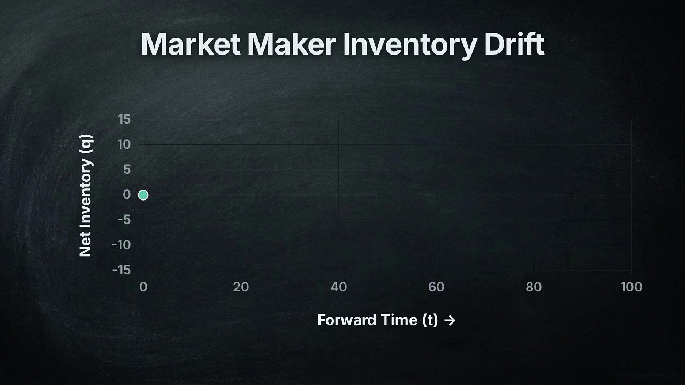

# Inventory Lab · RFQ / RESET

A small interactive market-making laboratory. Quote customer requests, carry
inventory, and compare a conventional dealer with a dealer that evaluates
costly partial inventory interventions. Every fill and hedge changes both
inventory and cash.

**[Open the live application](https://nalin-dhiman.github.io/interiit_15_quant/)**

The interface runs entirely in your browser. It has no accounts, API keys,
external trading connections, analytics, runtime libraries or server dependency.

## Quick overview

[](media/market-making-overview.mp4)

[Watch or download: The Physics of Market Making — Brownian Resetting in RFQ Markets](media/market-making-overview.mp4) · 8 min 56 sec

A visual introduction to RFQs, inventory risk, Brownian resetting, and the
project’s control approach.

## Use the bot

Choose a policy and a synthetic market, set a seed, then step through the session
or let it run. Change the quote edge, inventory skew, risk preference and
execution costs to inspect their effects. The charts show PnL, public prices
and inventory; the transaction ledger explains every cash movement.

The comparison tool runs the policies on matched exogenous paths in a Web
Worker. It reports actual session results and paired uncertainty, preserving
losses. Export the complete session or comparison for your own analysis.

Three policies are available:

| Policy | Decision |
|---|---|
| B3 · Inventory band | Quote around current prices and reduce exposure outside a conventional inventory band. |
| B4 · Basis-aware band | Use public settlement basis, execution costs and a partial target band. This is the default. |
| R2B · Continuation reset | Compare the conventional target, retaining inventory and partial reductions using an explicit finite continuation model. |

The browser exchange is a new, self-contained synthetic model. It illustrates
the research mechanism; it does not reproduce the separate SDK study below.
Research code for response estimation and conditional finite response bounds
is included in Python. Response adaptation is not enabled as an established
trading improvement.

## Run locally

Node 18 or newer is sufficient. There are no JavaScript dependencies to install.

```bash
git clone https://github.com/nalin-dhiman/interiit_15_quant.git
cd interiit_15_quant
npm run dev
```

Open `http://127.0.0.1:5173`. For a static build:

```bash
npm test
npm run build
node tools/serve.mjs --production
```

Only `web/` enters the deployment. The live site uses a prebuilt `gh-pages`
branch. To publish an update with an authorised Git credential, run
`npm run deploy`; it tests and builds the application before pushing that branch.
In repository Settings → Pages, select `gh-pages` and `/` as the publishing source.
Optional Actions templates are in `tools/github-actions/`; activating them
requires a credential with permission to create workflows.

## Python research library

The NumPy library contains signed self-financing accounting, simultaneous RFQ
reservation, settlement graphs, Brownian resetting diagnostics, exact finite
RFQ models, Bellman evaluation, baseline-policy improvement, likelihood/tangent
response and conditional uncertainty guards.

```bash
python3.11 -m venv .venv
.venv/bin/python -m pip install -r requirements.txt
.venv/bin/python -m unittest discover -s tests -v
.venv/bin/python -m experiments.run_foundation --sessions 12 --out runs/foundation
.venv/bin/python -m experiments.run_continuation --out runs/continuation
.venv/bin/python -m experiments.run_continuation_response --out runs/response
```

Use a new output directory for each experiment. The finite response example
uses the frozen conventional parameters in `data/finite-baselines.json`;
correct differentiation of that known model is not evidence of market alpha.
The complete scientific experiment harnesses, calibration studies, independent
audits and callback regressions are also included. Optional SDK experiments and
adapters require a separately installed, hash-verified organiser SDK; see
[SDK research setup and reproduction limits](docs/sdk-research.md). SDK files
and supplied datasets are not redistributed. They are not needed for the
application or ordinary NumPy tests.

## What the research found

The latest prospectively sealed attribution benchmark compares the policies
under shared information, a common development-selected parameter package and
an identical private inventory envelope. It includes **72,704 policy sessions
on 2,272 independent paths**. In its primary comparison, conventional B4
averaged **8.3337**, versus **6.8864** for R2B. The R2B-minus-B4 difference was
**−1.4474**, with a path-bootstrap 95% interval **[−2.2133, −0.6791]**.
This fails the predeclared +1 raw-PnL improvement objective. R2B had lower
measured inventory exposure, lower fees and a better descriptive fifth-percentile
outcome; an overall risk–return ranking is not established. Common allowed
exposure does not mean equal realised variance. This tests the implemented
continuation approximation in the declared synthetic mixture, rather than all
possible partial-hedging policies.

See [results and limitations](docs/ATTRIBUTION_RESULTS.md),
[the audited aggregates](data/constrained-attribution-results.json),
[the frozen protocol](docs/RISK_MATCHED_ATTRIBUTION_PROTOCOL.md),
[reproduction instructions](docs/CONSTRAINED_ATTRIBUTION_REPRODUCTION.md),
[the exposure constraint](docs/COMMON_RISK_ENVELOPE.md), and
[the refreshed prior-art comparison](docs/ATTRIBUTION_PRIOR_ART.md).
The original experiments below are separate cohorts and remain unchanged.

The historical synthetic SDK comparison contains **53,248 policy sessions on
2,048 independent price/customer paths**. The jointly selected R2B policy
averaged 26.8003 PnL versus 20.5547 for the preselected conventional B4 policy.
The paired difference was 6.2456, with a path-bootstrap interval [3.7343, 8.6708].

That result does **not isolate a benefit from resetting**. Matched-parameter
and fixed quoted-price reset contrasts were negative. In a fresh exploratory
parameter swap, conventional B4 and R2B with the same package averaged 33.0907
and 33.0042; the paired interval included zero. R2B also had a worse descriptive
downside outcome in the main study. Conventional B4 remains the reference.

A conditional fill estimator calibrated within its declared synthetic law;
transport to other trading environments is unestablished. Response and equally
informed direct refitting supplied no additional information advantage. Uniform
finite response guarantees require genuine model and derivative bounds;
fitted margins are not those bounds.

Machine-readable aggregate results are in
[`data/research-summary.json`](data/research-summary.json). They are historical
research evidence, separate from new browser runs. The sample-size cap bound
was reached, so the original planning power is not claimed. Secondary intervals
are descriptive, and no actual-market profitability claim is made.

## Project map

```text
web/engine/     Browser exchange, policies, ledger, random streams and worker
web/           Minimal interface and SVG charts
resetmm/       NumPy research models and mathematical diagnostics
tests-js/      Independent browser-engine regression tests
tests/         Python accounting, control, response and theorem checks
tests_sdk/     Explicitly gated optional SDK contract and controller regressions
experiments/   Reproducible synthetic and exact finite experiments
scripts/       Independent research ledger audits, analysis and callback profiles
submission/    Optional organiser-specific callback adapters
data/          Compact aggregate research results and frozen finite baselines
tools/         Local static server and deterministic build
```

See [the model](docs/model.md), [reproducibility](docs/reproducibility.md) and
[the research limits](docs/limitations.md). The manuscript and supplement are
maintained separately; they are not part of this code repository or deployment.

## Selected references

- Evans, M. R. & Majumdar, S. N. (2011). *Diffusion with stochastic resetting*.
  [Physical Review Letters 106, 160601](https://doi.org/10.1103/PhysRevLett.106.160601).
- Barzykin, A., Bergault, P. & Guéant, O. *Algorithmic market making in dealer
  markets with hedging and market impact*.
  [Author manuscript](https://arxiv.org/abs/2106.06974v6).
- Guilbaud, F. & Pham, H. (2013). *Optimal high-frequency trading with limit and
  market orders*. [Quantitative Finance 13, 79–94](https://doi.org/10.1080/14697688.2012.708779).
- Dai, J. G. & Yao, D. (2013). *Brownian inventory models with convex holding cost,
  Part 1: Average-optimal controls*.
  [Stochastic Systems 3, 442–499](https://doi.org/10.1287/11-SSY041).
- Maes, C. (2020). *Response Theory: A Trajectory-Based Approach*.
  [Frontiers in Physics 8, 229](https://doi.org/10.3389/fphy.2020.00229).

Resetting, impulse control and dealer hedging have substantial prior literature.
Their combination alone does not establish novelty or profitability.
